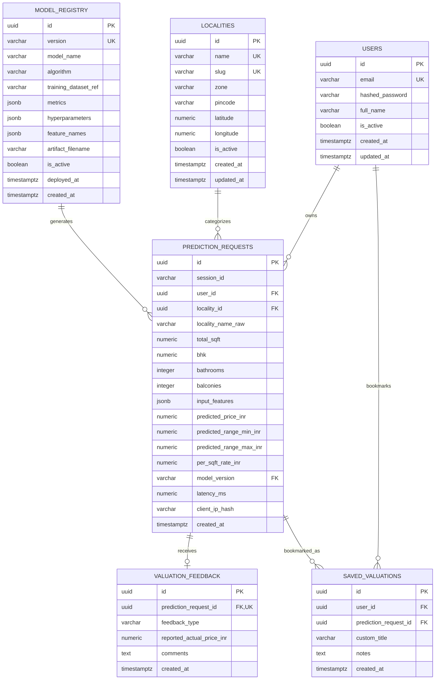

# PriceNest — Database Architecture & Schema Design

**Document Version:** 1.0.0  
**Phase:** Phase 1 — Project Foundation & Documentation  
**Database Engine:** PostgreSQL 15+ (Hosted on Supabase)  
**ORM & Migrations:** SQLAlchemy 2.0 (Async) + Alembic  
**Last Updated:** October 2026  

---

## 1. Overview & Database Philosophy

PriceNest utilizes a relational schema on PostgreSQL hosted on Supabase. The database architecture is designed with the following principles:

1. **Auditability & Reproducibility:** Every valuation request submitted to the inference API is recorded in an audit table with full input parameters, output valuations, and model version identifiers.
2. **Micro-Market Normalization:** Pune localities are maintained in a dedicated reference table, preventing misspelling anomalies and enabling localized aggregations.
3. **Model Governance:** Trained machine learning models and their offline evaluation metrics are tracked in a `model_registry` table.
4. **Data Privacy by Design:** No user passwords or unhashed IP addresses are stored. UUID v4 identifiers are used for all public primary keys.

---

## 2. Entity-Relationship (ER) Diagram

---

## 3. Detailed Table Specifications

### 3.1 `users` (User Accounts & Authentication)
Manages authenticated user credentials and profile state for private prediction history (PRD F-03, SRS FR-04).

| Column | Type | Constraints | Description |
| :--- | :--- | :--- | :--- |
| `id` | `UUID` | `PRIMARY KEY`, Default: `gen_random_uuid()` | Unique user identifier |
| `email` | `VARCHAR(255)` | `NOT NULL`, `UNIQUE`, Indexed | User's verified email address |
| `hashed_password` | `VARCHAR(255)` | `NOT NULL` | Cryptographically hashed password (Argon2id/bcrypt; never plaintext) |
| `full_name` | `VARCHAR(128)` | `NULLABLE` | Display name |
| `is_active` | `BOOLEAN` | `NOT NULL`, Default: `TRUE` | Active user status |
| `created_at` | `TIMESTAMPTZ`| `NOT NULL`, Default: `NOW()` | Registration timestamp |
| `updated_at` | `TIMESTAMPTZ`| `NOT NULL`, Default: `NOW()` | Profile update timestamp |

### 3.2 `localities` (Pune Micro-Market Reference Table)
Maintains authoritative Pune neighborhoods across PMC, PCMC, and PMRDA.

| Column | Type | Constraints | Description |
| :--- | :--- | :--- | :--- |
| `id` | `UUID` | `PRIMARY KEY`, Default: `gen_random_uuid()` | Unique locality identifier |
| `name` | `VARCHAR(128)` | `NOT NULL`, `UNIQUE` | Canonical locality name (e.g., "Baner", "Wakad", "Kothrud") |
| `slug` | `VARCHAR(128)` | `NOT NULL`, `UNIQUE`, Indexed | URL-safe slug (e.g., "baner", "wakad", "kothrud") |
| `zone` | `VARCHAR(64)` | `NOT NULL` | Zone classification (e.g., "West Pune", "East Pune", "Central Pune", "PCMC") |
| `pincode` | `VARCHAR(12)` | `NULLABLE`, Indexed | Primary postal code (e.g., "411045") |
| `latitude` | `NUMERIC(9,6)` | `NULLABLE` | Locality center latitude |
| `longitude` | `NUMERIC(9,6)`| `NULLABLE` | Locality center longitude |
| `is_active` | `BOOLEAN` | `NOT NULL`, Default: `TRUE` | Active flag for frontend selection |
| `created_at` | `TIMESTAMPTZ`| `NOT NULL`, Default: `NOW()` | Record creation timestamp |
| `updated_at` | `TIMESTAMPTZ`| `NOT NULL`, Default: `NOW()` | Record modification timestamp |

### 3.3 `model_registry` (ML Model Lifecycle & Governance)
Maintains metadata, hyperparameters, and evaluation metrics for each trained model artifact.

| Column | Type | Constraints | Description |
| :--- | :--- | :--- | :--- |
| `id` | `UUID` | `PRIMARY KEY`, Default: `gen_random_uuid()` | Unique registry record identifier |
| `version` | `VARCHAR(32)` | `NOT NULL`, `UNIQUE`, Indexed | Semantic version (e.g., "v1.0.0") |
| `model_name` | `VARCHAR(64)` | `NOT NULL` | Model identifier (e.g., "pricenest_pune_regressor") |
| `algorithm` | `VARCHAR(64)` | `NOT NULL` | Estimator type (e.g., "RandomForestRegressor", "HistGradientBoosting") |
| `training_dataset_ref` | `VARCHAR(128)` | `NOT NULL` | Dataset hash or filename reference |
| `metrics` | `JSONB` | `NOT NULL` | Offline validation metrics (`{"r2": 0.85, "mae_lakhs": 6.2, "rmse_lakhs": 9.1}`) |
| `hyperparameters` | `JSONB` | `NOT NULL` | Model configuration parameters |
| `feature_names` | `JSONB` | `NOT NULL` | Ordered array of expected input feature names |
| `artifact_filename` | `VARCHAR(128)` | `NOT NULL` | Serialized file name in `ml/models/` |
| `is_active` | `BOOLEAN` | `NOT NULL`, Default: `FALSE`, Indexed | Only one active model at a time |
| `deployed_at` | `TIMESTAMPTZ`| `NULLABLE` | Timestamp when promoted to active serving |
| `created_at` | `TIMESTAMPTZ`| `NOT NULL`, Default: `NOW()` | Record creation timestamp |

### 3.4 `prediction_requests` (Valuation Query Audit Ledger & Private History)
Captures every prediction query processed by the FastAPI backend. Linked to authenticated users for private prediction history (PRD F-04, SRS FR-05).

| Column | Type | Constraints | Description |
| :--- | :--- | :--- | :--- |
| `id` | `UUID` | `PRIMARY KEY`, Default: `gen_random_uuid()` | Unique prediction request identifier |
| `session_id` | `VARCHAR(64)` | `NOT NULL`, Indexed | Client session UUID or anonymous fingerprint |
| `user_id` | `UUID` | `NULLABLE`, `REFERENCES users(id)`, Indexed | Authenticated owner ID for private history retrieval |
| `locality_id` | `UUID` | `NULLABLE`, `REFERENCES localities(id)` | Foreign key to canonical locality |
| `locality_name_raw` | `VARCHAR(128)` | `NOT NULL` | Raw locality name submitted in query |
| `total_sqft` | `NUMERIC(10,2)`| `NOT NULL` | Property area in square feet |
| `bhk` | `NUMERIC(3,1)` | `NOT NULL` | BHK configuration (e.g., 2, 2.5, 3) |
| `bathrooms` | `INTEGER` | `NOT NULL` | Number of bathrooms |
| `balconies` | `INTEGER` | `NULLABLE` | Number of balconies |
| `input_features` | `JSONB` | `NOT NULL` | Full raw input payload |
| `predicted_price_inr` | `NUMERIC(14,2)`| `NOT NULL` | Point estimate in INR (e.g., 7500000.00) |
| `predicted_range_min_inr` | `NUMERIC(14,2)`| `NOT NULL` | Lower confidence bound in INR |
| `predicted_range_max_inr` | `NUMERIC(14,2)`| `NOT NULL` | Upper confidence bound in INR |
| `per_sqft_rate_inr` | `NUMERIC(10,2)`| `NOT NULL` | Calculated price per sq. ft. in INR |
| `model_version` | `VARCHAR(32)` | `NOT NULL`, Indexed | Version of model that generated prediction |
| `latency_ms` | `NUMERIC(8,2)` | `NOT NULL` | Inference duration in milliseconds |
| `client_ip_hash` | `VARCHAR(64)` | `NULLABLE` | Anonymized SHA-256 hash of client IP |
| `created_at` | `TIMESTAMPTZ`| `NOT NULL`, Default: `NOW()`, Indexed | Request timestamp |

### 3.5 `valuation_feedback` (User Evaluation & Ground Truth Collection)
Enables users to rate predictions or submit real transaction data (stored separately from training labels).

| Column | Type | Constraints | Description |
| :--- | :--- | :--- | :--- |
| `id` | `UUID` | `PRIMARY KEY`, Default: `gen_random_uuid()` | Unique feedback record identifier |
| `prediction_request_id` | `UUID` | `NOT NULL`, `UNIQUE`, `REFERENCES prediction_requests(id)` | Associated valuation query |
| `feedback_type` | `VARCHAR(32)` | `NOT NULL` | Feedback sentiment ("accurate", "too_high", "too_low") |
| `reported_actual_price_inr` | `NUMERIC(14,2)` | `NULLABLE` | Actual known price in INR (if user provided) |
| `comments` | `TEXT` | `NULLABLE` | Optional qualitative feedback |
| `created_at` | `TIMESTAMPTZ` | `NOT NULL`, Default: `NOW()` | Timestamp |

### 3.6 `saved_valuations` (User Bookmarks)
Stores bookmarked valuations for comparison.

| Column | Type | Constraints | Description |
| :--- | :--- | :--- | :--- |
| `id` | `UUID` | `PRIMARY KEY`, Default: `gen_random_uuid()` | Unique saved record identifier |
| `user_id` | `UUID` | `NOT NULL`, `REFERENCES users(id)`, Indexed | User identifier |
| `prediction_request_id` | `UUID` | `NOT NULL`, `REFERENCES prediction_requests(id)` | Associated prediction |
| `custom_title` | `VARCHAR(128)` | `NULLABLE` | User-defined label (e.g. "Baner 2BHK Option A") |
| `notes` | `TEXT` | `NULLABLE` | User notes |
| `created_at` | `TIMESTAMPTZ` | `NOT NULL`, Default: `NOW()` | Timestamp |

---

## 4. Indexing & Optimization Strategy

1. **Query Lookups:**
   - `localities(slug)`: Unique B-tree index for fast micro-market routing.
   - `localities(is_active)`: Filtered index for active dropdown items.
2. **Audit & Analytics:**
   - `prediction_requests(created_at DESC)`: B-tree index for chronological time-series slicing.
   - `prediction_requests(locality_id)`: Foreign key index for locality-based aggregation.
   - `prediction_requests(model_version)`: Filter index for per-model performance audits.
   - `prediction_requests USING gin (input_features)`: GIN index for JSONB attribute filtering.
3. **Model Governance:**
   - `model_registry(is_active)` WHERE `is_active = TRUE`: Partial unique index ensuring strictly one active model serving production traffic at any given time.

---

## 5. Alembic Migration Conventions

1. **Version Control:** All database schema changes are managed via Alembic scripts located in `backend/alembic/versions/`.
2. **Idempotence & Reversibility:** Every migration file must implement both `upgrade()` and `downgrade()` functions.
3. **Naming Convention:** Migration files follow `<revision_id>_<brief_slug>.py` (e.g., `0001_create_initial_schema.py`).
4. **Zero-Downtime Rule:** Column drops or type mutations must follow a multi-step expansion and contraction pattern to ensure compatibility during rolling updates on Render.
