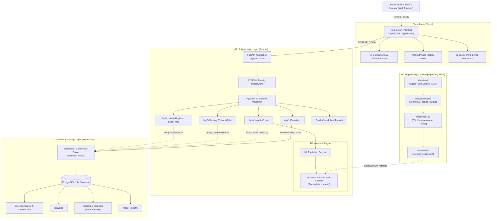
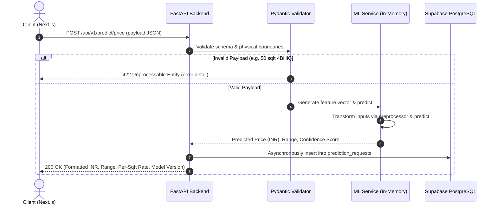

# PriceNest — System Architecture & Technical Specification

**Document Version:** 1.0.0  
**Phase:** Phase 1 — Project Foundation & Documentation  
**Target Deployments:** Frontend (Vercel) | Backend (Render) | Database (Supabase PostgreSQL)  
**Last Updated:** October 2026  

---

## 1. High-Level Architectural Overview

PriceNest follows a modern, decoupled, multi-tier cloud architecture designed for high developer velocity, robust request validation, authenticated user accounts with private history, and clean separation of concerns. Quantitative performance targets and SLAs will be empirically measured and established after the baseline model and backend are deployed (SRS NFR-03).

The core system consists of four primary subsystems:
1. **Frontend Presentation Tier:** Next.js (TypeScript) deployed to Vercel's global edge network.
2. **API & Business Logic Tier:** Asynchronous FastAPI application deployed as a web service on Render.
3. **Machine Learning Inference Subsystem:** Scikit-learn serialized pipelines managed via `joblib`, loaded into FastAPI memory via lifespan events.
4. **Data Persistence Tier:** PostgreSQL hosted on Supabase, accessed asynchronously via SQLAlchemy 2.0 with versioned Alembic migrations.

---

## 2. System Context & Component Architecture

---

## 3. Component Breakdown & Responsibilities

### 3.1 Frontend Tier (`frontend/`)
- **Technology:** Next.js (App Router), TypeScript, Vanilla CSS / Tailwind CSS.
- **Responsibilities:**
  - Render fast, accessible, responsive user interfaces across mobile and desktop.
  - Interactive property valuation form with client-side validation.
  - User registration, login, and private prediction history dashboard (PRD F-03, F-04).
  - Indian currency formatting engine converting raw figures to standard Lakhs (`₹XX.XX L`) and Crores (`₹X.XX Cr`).
  - Micro-market explorer displaying locality benchmarks and distributions.
  - Transparent display of dataset provenance and algorithmic valuation disclaimers.

### 3.2 Backend API Tier (`backend/`)
- **Technology:** Python 3.11+, FastAPI, Pydantic v2, Starlette.
- **Responsibilities:**
  - Enforce strict typing and runtime payload validation using Pydantic models.
  - Enforce user authentication, password hashing, and strict ownership authorization for private history (SRS FR-04, FR-05).
  - Coordinate the request lifecycle: validation $\to$ feature vector synthesis $\to$ model inference $\to$ database audit logging $\to$ response formatting.
  - Expose health check probes (`/health/live`, `/health/ready`) for automated orchestration.
  - Manage database connectivity using `asyncpg` and SQLAlchemy async sessions.

### 3.3 ML Modeling & Inference Subsystem (`ml/`)
- **Technology:** Pandas, NumPy, Scikit-learn, Joblib.
- **Responsibilities:**
  - Ingestion, cleaning, outlier handling, and feature transformations.
  - Training cross-validated regression models predicting property prices.
  - Exporting serialized pipeline artifacts bundling column transformers (OneHotEncoder, StandardScaler) and the trained regression model.
  - Model evaluation reporting ($R^2$, MAE, RMSE, MAPE).

### 3.4 Persistence & Migrations Tier (`backend/alembic/` & Supabase)
- **Technology:** PostgreSQL 15+, SQLAlchemy 2.0, Alembic.
- **Responsibilities:**
  - Persist reference data (Pune localities, boundaries, postal codes).
  - Record an immutable audit log of valuation requests for analytical drift detection.
  - Maintain model registry metadata (version, training date, hyperparameters, evaluation metrics).
  - Execute zero-downtime, versioned database schema migrations.

---

## 4. End-to-End Prediction Request Lifecycle

---

## 5. Machine Learning Model Hosting Strategy (Deferred Protocol)

### Current Architecture Decision
The formal decision regarding the production ML model hosting infrastructure is **explicitly deferred** until the training pipeline is complete and the model size and inference latency have been experimentally measured.

### Evaluated Hosting Candidates:

| Architecture Option | Description | Pros | Cons | Recommendation |
| :--- | :--- | :--- | :--- | :--- |
| **Option A: In-Process FastAPI Loading (Lifespan)** | Load `.joblib` model pipeline directly into memory at FastAPI startup via `lifespan`. | Zero network hop (<5ms internal inference), zero extra infrastructure cost, simple single-service deployment on Render. | Consumes FastAPI container RAM; scaling web workers scales model memory replicas. | **Preferred Baseline** for Phase 1-3 if model artifact < 100MB. |
| **Option B: Independent Microservice (BentoML / Triton)** | Run a dedicated model serving container exposed over gRPC/REST. | Decoupled scaling of ML compute from API web workers; specialized hardware targeting. | Additional operational complexity, extra network latency (15-40ms hop), higher cloud cost. | Evaluate only if model artifact > 500MB or requires GPU. |
| **Option C: Serverless Inference (Cloud Run / AWS Lambda)** | Package model into a serverless container invoked on demand. | Pay-per-invocation, scales to zero. | Cold start penalties (2-8 seconds), memory threshold constraints. | Not recommended due to cold start latency impacting user experience. |

### Decision Criteria:
During Phase 3 (Model Training & Evaluation), the team will benchmark:
1. Serialized artifact size (`.joblib` file size).
2. Memory consumption per worker process.
3. p95 and p99 inference latency under simulated concurrent load.
If artifact size is under 150MB and inference completes in $<25\text{ms}$ on CPU, **Option A (In-Process)** will be ratified for production deployment on Render.

---

## 6. Security, Resilience & Error Handling

1. **Input Boundary Guardrails:**
   - Pre-inference validation enforces domain-specific physical rules (e.g., minimum 150 sq.ft. per bedroom, positive non-zero floor numbers).
2. **CORS Whitelisting:**
   - Origins restricted to explicit frontend production and staging URLs. Wildcard (`*`) origins are prohibited in production.
3. **Environment Security:**
   - All credentials, Supabase connection strings, and application keys are injected strictly via container environment variables. No `.env` files are baked into Docker images or committed to Git.
4. **Database Resiliency:**
   - Async connection retry logic and connection pool recycling (`pool_recycle=1800`, `pool_pre_ping=True`) to handle transient Supabase network disconnects smoothly.
